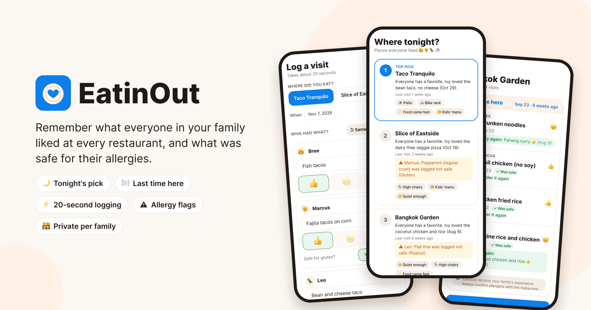
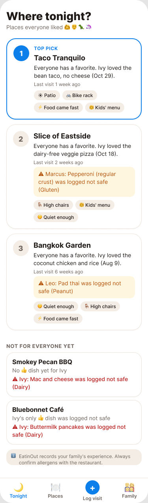
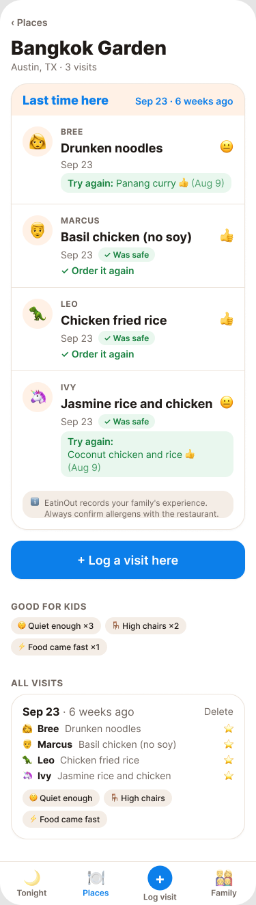
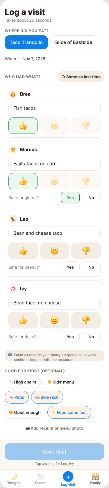
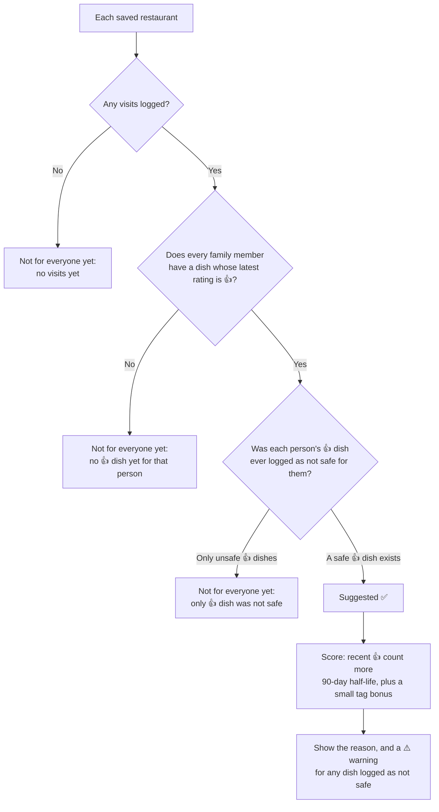
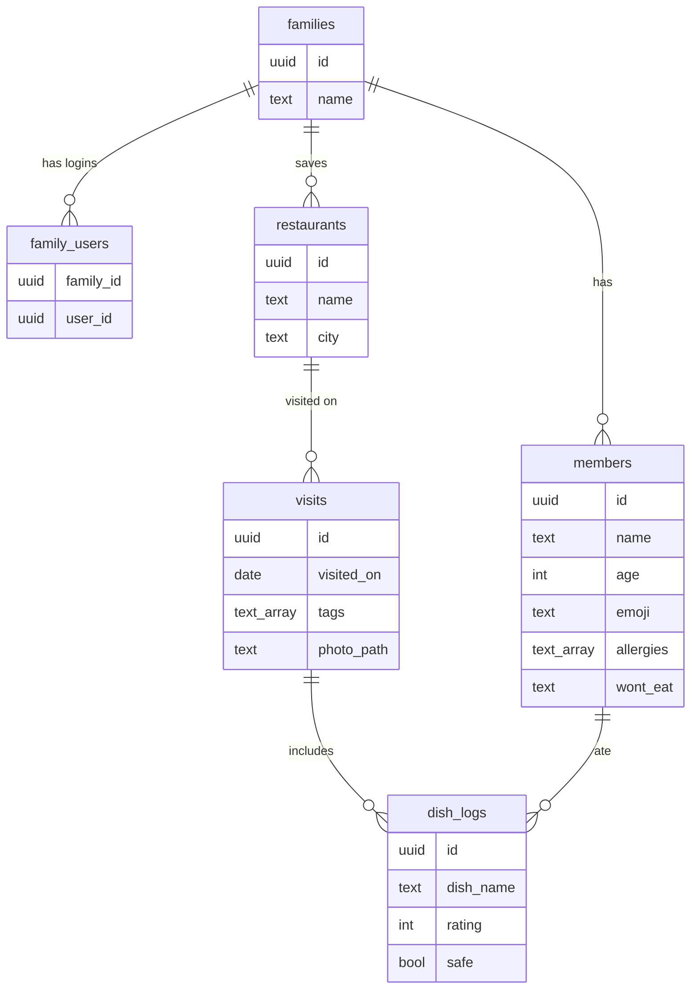

<p align="center">
  
</p>

<p align="center">
  <b>Remember what everyone in your family liked at every restaurant, and what was safe for their allergies.</b>
</p>

<p align="center">
  
  
  
  
  
  
  
</p>

# EatinOut

Young families eat out a lot, but nobody remembers which tacos the six-year-old actually eats, or which dish was safe for the kid with the dairy allergy. **EatinOut** is a mobile-first app that logs a family meal in about 20 seconds and turns that history into answers:

- 🌙 **Where should we go tonight?** Ranks your saved places, but only suggests one where *everyone* has a dish they liked.
- 🍽️ **Last time here.** Open a restaurant and see what each person ordered, how they rated it, when, and whether it was safe for them.
- ⚡ **Fast logging.** One screen, big 👍 😐 👎 buttons a child can tap, and "Same as last time" to prefill everyone's dish.
- ⚠️ **Allergy flags.** Dishes logged as not safe show a warning and are never suggested again.
- 🔒 **Private per family.** Each account gets its own family, locked down with row-level security.

> EatinOut records your family's experience. Always confirm allergens with the restaurant.

## Screens

<table>
  <tr>
    <th align="center">Where tonight?</th>
    <th align="center">Last time here</th>
    <th align="center">Log a visit</th>
  </tr>
  <tr>
    <td valign="top"></td>
    <td valign="top"></td>
    <td valign="top"></td>
  </tr>
  <tr>
    <td valign="top">Ranked picks with a one-line reason. Places where someone has no liked dish, or only unsafe ones, wait in <i>Not for everyone yet</i>.</td>
    <td valign="top">The core screen: who ate what, with dates (kids' tastes change), safety badges and a <i>Try again</i> suggestion.</td>
    <td valign="top">Everything on one screen. Tap a place, tap <i>Same as last time</i>, rate each dish, save.</td>
  </tr>
</table>

<sub>Shown with Bree's demo family: Bree, Marcus (gluten), Leo, 6 (peanut) and Ivy, 3 (dairy), in Austin, TX.</sub>

## How the tonight picker decides



## Data model

Every row belongs to one family, and row-level security means a signed-in user can only ever read or change their own family's rows.



## Tech

React 19, Vite, TypeScript, Tailwind CSS v4 and React Router on the front end; Supabase (Postgres, Auth, Storage) on the back end; Vitest for the rules that matter most. A brand-new account can tap **"Try with Bree's demo family"** to load 5 Austin restaurants and 15 visits, so every screen can be tried without typing.

## Run it locally

Requires Node 20+.

```bash
npm install
cp .env.example .env.local   # then fill in your Supabase URL and publishable key
npm run dev                  # http://localhost:5173
```

Restart `npm run dev` after changing `.env.local`; Vite only reads it at startup.

## Scripts

| Command | What it does |
| --- | --- |
| `npm run dev` | Start the dev server |
| `npm test` | Run the unit tests (ranking and "last time here" rules) |
| `npm run typecheck` | TypeScript check |
| `npm run build` | Typecheck and build to `dist/` |
| `npm run preview` | Serve the production build |

## Environment variables

| Variable | Where to find it |
| --- | --- |
| `VITE_SUPABASE_URL` | Supabase → Project Settings → API |
| `VITE_SUPABASE_PUBLISHABLE_KEY` | Supabase → Project Settings → API Keys (`sb_publishable_...`) |

The publishable key is designed to be public; RLS protects the data. **Never** put the secret / `service_role` key in this app. `.env.local` is git-ignored.

## Database

- Schema, RLS policies, signup trigger and the `visit-photos` storage bucket: `supabase/migrations/20261107190000_init_eatinout.sql`
- Privacy test: `supabase/tests/rls_isolation.sql` creates two throwaway families inside a transaction, checks neither can read or change the other's rows or photos (and that signed-out users see nothing), then rolls back. Paste it into the Supabase SQL editor to re-run; it prints `RLS isolation: all checks passed` or raises an error.

Tables: `families`, `family_users` (which login belongs to which family), `members`, `restaurants`, `visits` (tags stored as an array), `dish_logs`. Every table carries `family_id`, and composite foreign keys stop a visit or dish from pointing at another family's rows.

For sign-up to work without an email round-trip, turn off **Authentication → Sign In / Providers → Email → Confirm email** in the Supabase dashboard. Add your deployed URL under **Authentication → URL Configuration** when you deploy.

## Deploy to Vercel

```bash
vercel          # preview
vercel --prod   # production
```

Vercel detects Vite automatically. Add the two `VITE_SUPABASE_*` variables in the Vercel project settings. `vercel.json` sends every route to `index.html` so deep links work.

## How it works

| Screen | Route | Notes |
| --- | --- | --- |
| Tonight | `/tonight` | Ranked picks with a reason, unsafe-dish warnings, and a "Not for everyone yet" list |
| Places | `/restaurants` | Saved restaurants, add a new one |
| Last time here | `/restaurants/:id` | What each person had last time, rating, date, safe flag, and a "try again" dish |
| Log visit | `/log` | One screen: place, date, a dish and 👍/😐/👎 per person, safe yes/no, tags, photo |
| Family | `/family` | Members, allergies, "won't eat" notes |

### Ranking rules (`src/lib/ranking.ts`)

- A dish counts as **liked** if its **latest** rating is 👍, so a kid's changed taste stops counting.
- A place is suggested **only if every member has at least one liked dish** there that was never logged as not safe for them.
- Places that fail that rule are listed under "Not for everyone yet" with the reason, never ranked.
- Any dish logged as not safe shows a warning.
- Score favors recent 👍 ratings (90-day half-life), with a small bonus for family-friendly tags.

### Code map

```
src/
  lib/types.ts          data model (mirrors future DB tables)
  lib/supabase.ts       Supabase client (reads the VITE_ env vars)
  lib/store/remote.ts   load/save rows, snake_case <-> app types
  lib/store/StoreProvider.tsx  auth session, optimistic saves, actions
  lib/ranking.ts        tonight picker
  lib/lastTime.ts       "last time here" + "try again"
  lib/seed.ts           Bree's demo family (loaded per account on request)
  screens/              one file per screen
  components/           shared UI
supabase/
  migrations/           database schema and RLS
  tests/                RLS isolation test
docs/images/            README banner and screenshots
```
